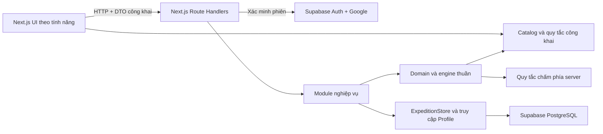

# Kiến trúc hệ thống ATLAS Hub

Đề xuất cho mã nguồn tại commit `824aa83`. Giữ ATLAS dưới dạng **modular monolith** với một ứng dụng Next.js và một cơ sở dữ liệu Supabase PostgreSQL. Chia code theo tính năng trong cùng ứng dụng để nhóm có thể sửa từng luồng độc lập, đồng thời giữ các cập nhật tiến trình chung trong một lần ghi.

## Hiện trạng

| Khu vực | Mã nguồn và vai trò |
| --- | --- |
| Giao diện | `app/page.tsx` gắn `Game.tsx`. `Game` điều phối phiên, điều hướng, tùy chọn học và các màn hình Nature, Travel, sổ từ và lịch học. |
| HTTP và danh tính | `app/auth/` xử lý Google OAuth qua Supabase. Route catch-all `app/api/[...path]/route.ts` gọi `vercel-handler.ts` để kiểm tra origin của POST, xác minh người dùng và phân luồng sang Profile, Tower hoặc API expedition. |
| Nghiệp vụ | `lib/atlas/service.ts` xử lý nhiều route của Nature, Travel, tiếng Anh, sổ từ, resume và lịch học. Reward, checkpoint và ghi ngày học đã có helper riêng. |
| Quy tắc và học liệu | `packages/` có domain, mission, English và Tower engine. `content/` chứa học liệu và catalog. Travel lấy quy tắc chấm từ `lib/atlas/travel-rules.ts`. Tower có luồng DRAFT cục bộ với kho tạm. |
| Lưu trữ | `atlas_profiles` lưu hồ sơ và tùy chọn học. `atlas_expeditions` lưu document và revision theo tài khoản. Supabase adapter thực hiện ghi có điều kiện theo UUID và revision. Migration kiểm tra tính nhất quán của ledger và tiến trình. |

Ba điểm ưu tiên refactor xuất hiện ngay trong mã nguồn. `service.ts` trộn HTTP, điều kiện mở khóa, chấm, projection và vòng lặp ghi. `chapter-types.ts` chứa cả DTO lẫn HTTP client dù nhiều tính năng cùng dùng. `WorldTravel.tsx` và mission engine cùng tính điều kiện mở điểm dừng, trong khi module engine còn import ngược vào `lib/atlas`. Những điểm này làm tăng số nơi phải sửa khi đổi cùng một hành vi.

## Ranh giới module đề xuất

| Module | Sở hữu |
| --- | --- |
| Account | Hồ sơ, tên hiển thị, sở thích, reading target và hỗ trợ tiếng Việt. |
| Nature và Travel | Mỗi module sở hữu command, điều kiện mở khóa, trạng thái riêng và cách áp dụng kết quả chấm. Travel sở hữu stamp và luồng chọn điểm dừng. |
| English | Các bài luyện, bộ chấm và bằng chứng học. Bài luyện thuộc một chặng đi qua hợp đồng của chặng đó để kiểm tra điều kiện. |
| Vocabulary | Lưu, bỏ lưu và đọc danh sách từ. Luồng lưu tra catalog và dùng lại điều kiện mở khóa tương ứng. |
| Expedition | Định dạng document, revision, projection, XP, ledger và checkpoint chuẩn. Điều phối ghi chung cho các command trên expedition. |
| Study và Tower | Study sở hữu điều kiện ghi nhận ngày và phép tính streak. Tower sở hữu trạng thái lượt chơi và hợp đồng riêng, với DRAFT tiếp tục chạy trên kho tạm cục bộ. |

Giữ các thư mục hiện hữu. Khi một lát cắt có đủ code để tách, đặt UI ở `app/components/<feature>/` và điều phối server ở `lib/atlas/<feature>/`. Đặt hợp đồng API dùng chung trong `lib/atlas/contracts/` và HTTP client ở `lib/atlas/api-client.ts` khi chuyển `chapter-types.ts`. Module UI đọc DTO, catalog công khai và các hàm thuần phù hợp. Entry point chấm và quy tắc đáp án thuộc ranh giới server. Giữ `packages/` cho domain và engine, với đầu vào tường minh khi bộ chấm cần quy tắc riêng của học liệu. Adapter Supabase triển khai interface lưu trữ đang có.

## Luồng ghi tiến trình

1. Route xác minh phiên Supabase, lấy UUID từ danh tính đã xác minh, kiểm tra origin cho mutation và xác thực body tại biên HTTP.
2. Module xử lý command trên document của tài khoản ở revision hiện tại. Bộ chấm tính kết quả từ nội dung phiên bản tương ứng. Server áp dụng XP, ledger, stamp, checkpoint và ngày học nếu đủ điều kiện.
3. Adapter ghi document với điều kiện UUID và revision cùng khớp. Nếu command cho phép retry nội bộ, tải revision mới và đánh giá lại hành động. Với thao tác cần `expectedRevision`, như checkpoint hoặc restart, trả lỗi xung đột theo hợp đồng hiện hành khi client đã cũ.
4. Trả DTO từ trạng thái đã commit. Giữ cách đọc document cũ khi thiếu các trường được thêm sau. Profile có đường ghi riêng và dùng cùng UUID.

Điều kiện mở điểm dừng Travel là ứng viên đầu tiên để tái sử dụng. Hàm thuần nhận thứ tự các điểm dừng và trạng thái hoàn thành, rồi phục vụ cả việc hiển thị ở UI lẫn kiểm tra trên server. Khóa đáp án vẫn thuộc bộ chấm phía server.

## Vận hành và mở rộng

Next.js và Supabase tiếp tục là hai thành phần triển khai. Dùng Postgres/PostgREST cục bộ cho kiểm thử transaction và môi trường preview hoặc staging có dữ liệu riêng khi xác minh OAuth hoặc migration. Trước khi quyết định chia bảng expedition, đo kích thước document, độ trễ lưu p95 và tỷ lệ xung đột revision hoặc 409 theo route. Log mã lỗi và request ID để truy vết, đồng thời loại token, đáp án và nội dung học cá nhân khỏi log. Khi số đo cho thấy lịch sử làm chậm đường ghi, xem xét tách lịch sử và thiết kế backfill có kiểm chứng với transaction vẫn giữ được tính nhất quán của thưởng.

## Thứ tự triển khai

1. **Hợp đồng và quy tắc Travel.** Chuyển `atlasApi` và các DTO ra khỏi `chapter-types.ts` theo từng nhóm caller. Dùng một quy tắc mở điểm dừng ở cả UI và server, đồng thời bỏ chiều import ngược từ engine vào `lib/atlas`. Đối chiếu kiểu trả về, trạng thái khóa và hành vi resume.
2. **Tách một lát API.** Bắt đầu từ Travel hoặc Vocabulary. Đưa xử lý command và projection theo tính năng ra khỏi HTTP dispatcher trong khi giữ URL, status, error code, cache header và định dạng response. Đối chiếu hành vi CAS của expedition và Tower trước khi dùng chung phần giống nhau. Sau đó chuyển các nhánh còn lại khi chúng cần thay đổi.
3. **Thu gọn UI theo luồng.** Để `Game` giữ phiên và điều hướng chung. Chuyển trạng thái và thao tác gắn với Nature hoặc Travel vào module tương ứng. Tái sử dụng hook hay component khi chúng có cùng hành vi.

Với các lát API và UI, dùng lại `test-response-types.ts`, `test-travel.mts`, `test-vocabulary.mts` và `test-navigation-v2.mts` theo phạm vi. Với lát ghi tiến trình, chạy thêm các ca PostgreSQL cho cập nhật đồng thời, retry sau mất phản hồi, revision cũ, dữ liệu cũ, cô lập tài khoản và không cộng trùng thưởng. Dùng `test-tower.mts` và kiểm tra import hiện có khi thay đổi ranh giới Tower.

Các quyết định nền tảng được ghi tại [ADR World Travel](world-travel/ADR-001-authoritative-travel.md), [ADR học liệu và bản đồ](world-travel/ADR-002-content-and-map.md), [ADR danh tính và resume](auth-02/ADR-003-player-ownership.md) và [thiết kế lịch học](study-calendar/implementation.md).
