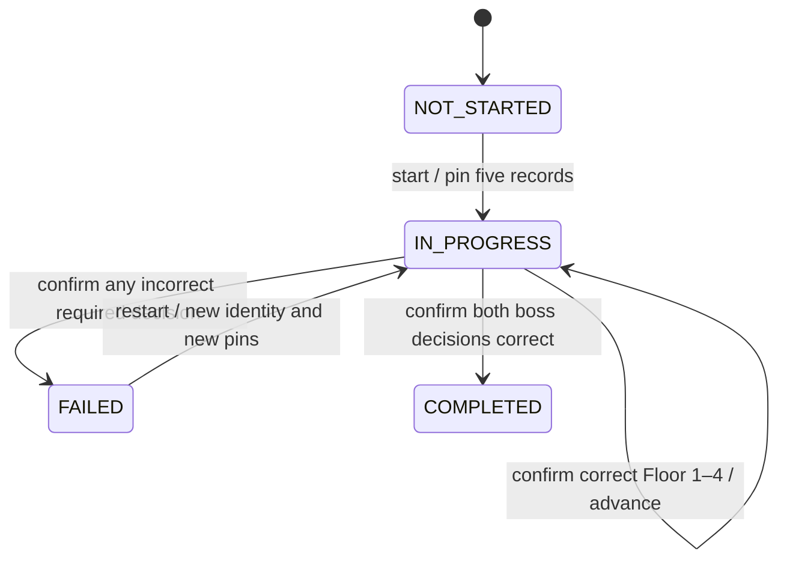

# T1 state transitions

Local prototype, 2026-10-28. Five floors total; Floor 5 is a two-decision boss. C0's atomic boss confirmation remains authoritative.

Invalid requests return the identical input state and `isLanguageMistake:false`. New scoring commands against terminal states are rejected. Identical operation retries return the saved receipt without a transition, including after completion/failure. COMPLETED has no restart transition in this prototype; future repeat practice requires a separately authorized lifecycle.

## Boss oracle

Both choices must be selected and then confirmed together. Selecting only the first correct answer cannot grade or advance. All submitted parts receive honest feedback; the advancement counter measures the consecutive correct prefix, not total correct answers.

| Boss p1/p2 | State | Cleared floors | Advanced decisions | Feedback |
|---|---|---:|---:|---|
| correct/correct | COMPLETED | 5 | 6 | Both correct |
| correct/wrong | FAILED | 4 | 5 | First correct, second wrong |
| wrong/correct | FAILED | 4 | 4 | First wrong, second correct |
| wrong/wrong | FAILED | 4 | 4 | Both wrong |

One atomic boss submission creates one revision increment and one receipt containing two part results. There is no externally persisted half-cleared boss. C0's conceptual CLEARED is named COMPLETED per T1; selection is `selections`, separate from scoring revision. A correct part after a wrong part is recorded as correct but does not advance the terminated run.

## Operation example

`select(run-1, revision 0, pinned question, p1, c2)` creates a draft selection. `submit` requires the same target, `confirmed:true`, all selected answers, and an `operationId`. The server-owned evaluator decides whether c2 is correct. Unknown choices are invalid requests, not language mistakes.

After a successful commit of `op-1`, retrying it returns its original receipt even if the current revision is newer. Fingerprinting includes run/question/revision and answers sorted by part ID. Expected run revision is a concurrency precondition, not semantic payload; refreshing it does not change a replay. Reusing the identity with different answers returns OPERATION_CONFLICT. The response contains current state plus the historical receipt; a future client must not replace current state with the receipt's older cursor.

This is an in-memory pure contract. A network failure invokes no scoring transition. A lost response after a durable commit must recover the stored receipt in T2; no database/network behavior is implemented here.
